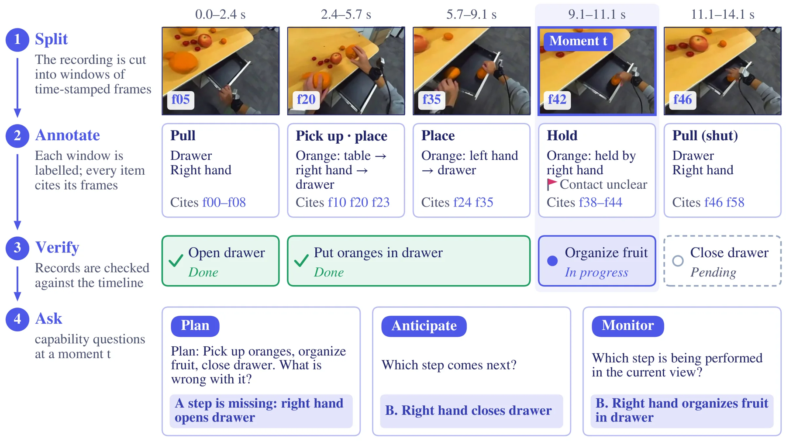

<div align="center">


# ACE-Brain-0.7: Learning Execution-Grounded Reasoning for Embodied Agents

**ACE-Brain Team**

[](https://acerobotics2025.github.io/ACE-Brain-0.7/)
[](https://arxiv.org/abs/2611.26519)
[](https://arxiv.org/pdf/2611.26519)

[](https://huggingface.co/datasets/ACERobotics/ACE-Brain-0.7-Bench)
[](LICENSE)

[News](#news) | [Introduction](#introduction) | [Key Features](#key-features) | [Method](#method--architecture) | [Performance](#performance-highlights) | [Evaluation](#evaluation) | [Tech Report](https://arxiv.org/pdf/2611.26519) | [Citation](#citation) | [Contributors](#contributors)

</div>

## News

- **2026-11**: We release ACE-Brain-0.7 (9B), the evaluation code and the benchmark data ([`ACERobotics/ACE-Brain-0.7-Bench`](https://huggingface.co/datasets/ACERobotics/ACE-Brain-0.7-Bench)). Previous release: [ACE-Brain-0.6](https://github.com/DAXIAORobotics/ACE-Brain-0.6).

## Introduction

**ACE-Brain-0.7** is a 9B vision-language model (Qwen3.5-9B fine-tuned on 3.7M execution-grounded question-answer pairs from egocentric human video, robot episodes and simulation) that combines spatial grounding, task understanding and progress estimation. Predictions are grounded in the execution state observed so far, not only in the instruction.

## Key Features

- **Execution-grounded reasoning**: conditioned on visual history and the current execution state.
- **One 9B model, three skills**: spatial grounding, task understanding, progress estimation.
- **Task reasoning**: Avg6 of 76.5 vs 72.7 (GPT-6 Astra) and 73.5 (Claude Opus 5.5).
- **Spatial grounding**: best Avg7 (75.90) and 91.25 Acc@0.5 on RefCOCOg.
- **Open evaluation**: exact prompts, parsers and scorers in [`eval/`](eval/).

## Method

Questions are posed at different stages of an execution, so the model must judge progress, outcome and next step from the frames observed so far.

<div align="center">

</div>

## Performance

**Task reasoning (Avg6).** Progress MAE is lower-is-better.

| Model | EgoPlan-Bench | Cosmos-Reason1 | RoboBench | LADDER | RoboFAC | ERIQ | Avg6 | Progress MAE |
|---|---|---|---|---|---|---|---|---|
| **ACE-Brain-0.7 (9B)** | **74.5** | **83.5** | **67.4** | **79.0** | **69.2** | **85.1** | **76.5** | **0.087** |
| GPT-6 Astra | 75.9 | 77.5 | 66.0 | 75.7 | 53.2 | 87.9 | 72.7 | 0.125 |
| Claude Opus 5.5 | 70.1 | 76.5 | 68.9 | 79.5 | 57.7 | 88.4 | 73.5 | 0.118 |
| Qwen3.5-9B | 48.8 | 62.0 | 55.6 | 68.8 | 35.9 | 71.4 | 57.1 | 0.257 |
| Qwen3.5-27B | 56.1 | 66.7 | 60.2 | 74.3 | 43.7 | 77.6 | 63.1 | 0.215 |
| Cosmos-Reason2-32B | 44.3 | 73.9 | 55.0 | 60.0 | 48.2 | 71.9 | 58.9 | 0.220 |

**Spatial grounding (Avg7).** RefCOCOg is reported separately and not part of Avg7.


| Model | Where2Place | PixMo-Count | RoboSpatial | RefSpatial | PointArena | RoboAfford | ShareRobot | Avg7 | RefCOCOg |
|---|---|---|---|---|---|---|---|---|---|
| **ACE-Brain-0.7 (9B)** | **82.89** | **89.98** | **73.13** | **76.17** | **76.17** | **88.66** | **44.31** | **75.90** | **91.25** |
| Claude Opus 5.5 | 66.44 | 83.74 | 73.30 | 71.10 | 61.20 | 75.10 | 40.20 | 67.30 | 85.89 |
| Gemini 4 Argon | 71.20 | 87.71 | 80.94 | 51.56 | 66.40 | 71.48 | 29.53 | 65.55 | – |
| GPT-6 Astra | 71.10 | 88.10 | 69.55 | 80.14 | 75.36 | 84.94 | 46.60 | 73.68 | 89.05 |
| Qwen3.5-9B | 72.00 | 90.35 | 53.46 | 57.76 | 68.33 | 78.65 | 39.47 | 65.72 | 89.98 |
| Embodied-R1.5-8B | 77.00 | 81.70 | 68.96 | 57.04 | 71.38 | 83.43 | 37.21 | 68.10 | 86.30 |
| ACE-Brain-0.6 | 81.44 | 86.96 | 76.56 | 71.84 | 74.13 | 88.14 | 48.82 | 75.41 | 83.27 |

Full tables, protocol details and per-benchmark deviations: [`eval/RESULTS.md`](eval/RESULTS.md), [`eval/README.md`](eval/README.md).

## Evaluation

```bash
cd eval && pip install -e . huggingface_hub
HF_REPO=ACERobotics/ACE-Brain-0.7-Bench python prepare.py --from-hub      # download + sha256 check
bash benchmarks/ladder/download.sh && python benchmarks/ladder/prepare.py  # EgoPlan / LADDER: build from official sources
bash benchmarks/egoplan/download.sh && python benchmarks/egoplan/prepare.py
python benchmarks/eriq/eval.py  --model /path/to/hf_checkpoint --out results/eriq     # inference
python benchmarks/eriq/score.py --pred results/eriq/predictions.jsonl                 # score
bash scripts/run_all.sh /path/to/hf_checkpoint results/mymodel                        # all benchmarks
```

Judged benchmarks need `JUDGE_BASE_URL` / `JUDGE_API_KEY` (paper judge: `qwen3.8-flash`).

## Maintaining the page

After editing `data/*.json` run `python3 tools/build_data.py` (regenerates the `data/*.js` mirrors) and bump the `?v=` query on the `styles.css`, `app.js` and `data/*.js` links in `index.html`. Preview with `python3 -m http.server 8000`; enable GitHub Pages from branch `main`, folder `/ (root)`.

## Citation

```bibtex
@misc{acebrain07,
  title  = {ACE-Brain-0.7: Learning Execution-Grounded Reasoning for Embodied Agents},
  author        = {{ACE-Brain Team}},
  year          = {2026},
  eprint        = {2611.26519},
  archivePrefix = {arXiv},
  primaryClass  = {cs.RO},
  url           = {https://arxiv.org/abs/2611.26519}
}
```

## Acknowledgements

Built on [Qwen3.5-9B](https://huggingface.co/Qwen). We thank the authors of all benchmarks and EmbodiedEvalKit for releasing their data and code.

## Contributors

**Contributors:** Yinhe Wang<sup>1,*</sup>, Shijun Shi<sup>1,3,*</sup>, Feng Pan<sup>1,*</sup>, Tao Tao<sup>1</sup>, Wei Mao<sup>1</sup>, Jiangning Zhang<sup>3</sup>, Zhiyao Ren<sup>1</sup>, Yihang Jiao<sup>1</sup>, Haoming Gu<sup>1</sup>, Yunpeng Qing<sup>1</sup>, Jiyu Guo<sup>1</sup>.

**Advisors:** Zhi Hou<sup>1</sup>, Dacheng Tao<sup>2</sup>, Xiaogang Wang<sup>1</sup>.

<sup>1</sup> ACE Robotics &nbsp; <sup>2</sup> Nanyang Technological University &nbsp; <sup>3</sup> Zhejiang University

<sup>*</sup> Equal contribution.

## License

Code: Apache-2.0 ([LICENSE](LICENSE), [NOTICE](NOTICE)). Benchmark data keeps the license of its source, see [`eval/LICENSES.md`](eval/LICENSES.md).
